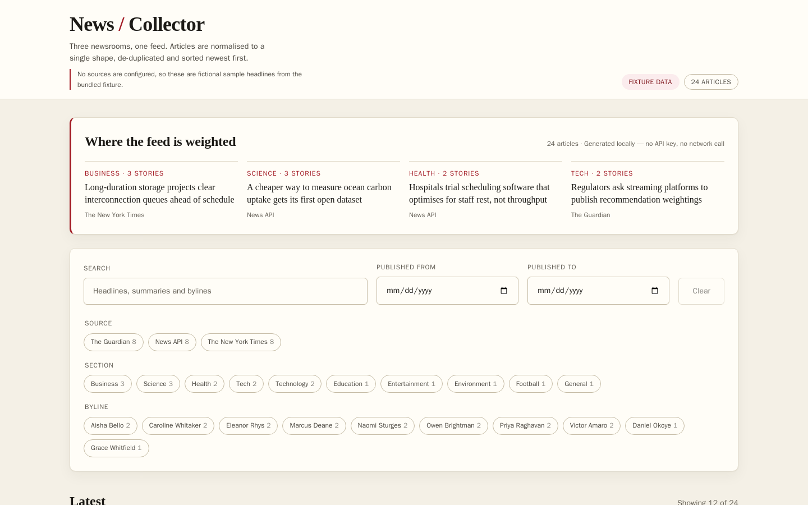
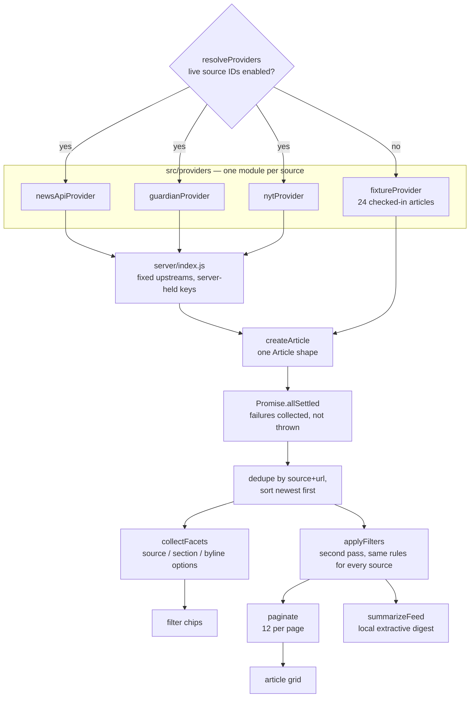
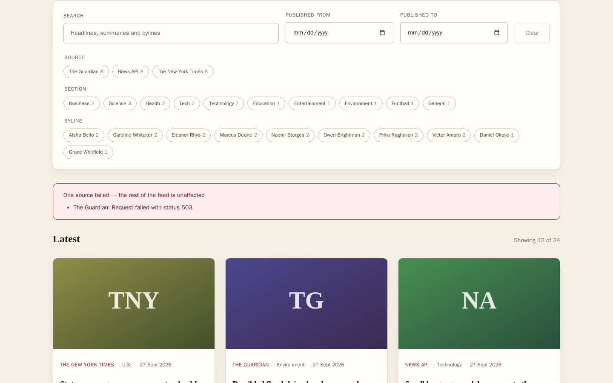
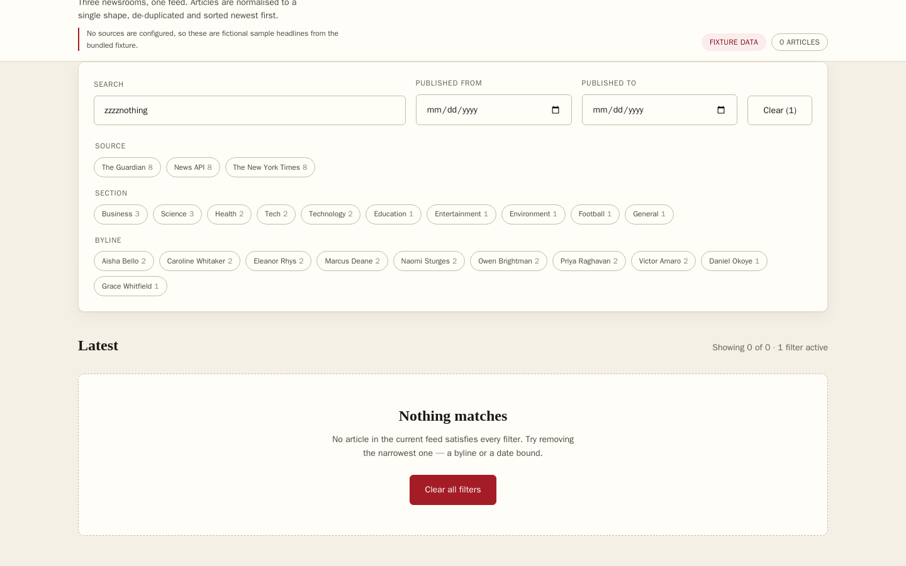
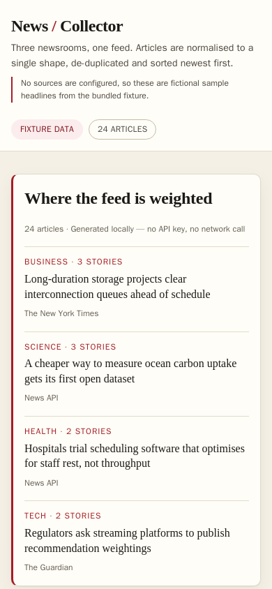

# News Collector

Three newsrooms — [NewsAPI](https://newsapi.org), [The Guardian](https://open-platform.theguardian.com)
and the [New York Times](https://developer.nytimes.com) — publish the same kind of thing in three
incompatible shapes. This pulls all three, flattens them into one `Article`, and renders a single
filterable feed. A small Node server sits in front of the APIs so the keys never reach the browser.



It runs with **no API keys at all**. When no source is enabled, the provider registry falls back to
a checked-in fixture of 24 fictional articles (every link points at `example.com`), so a fresh clone
shows the page above rather than an empty grid and a console error. The masthead says so in plain
words whenever the fixture is what you are looking at.

---

## Running it

Use Node 22 (`.nvmrc`; Vite 8 needs 22.12 or newer).

```bash
npm ci
npm run dev          # http://localhost:7141, fixture data
```

For live sources, put keys in the server environment and enable the matching public source IDs:

```bash
cp .env.example .env.local
# set NEWSAPI_KEY / GUARDIAN_KEY / NYT_KEY; never prefix secrets with VITE_
# set VITE_NEWS_SOURCES=guardian,nyt (only sources with configured server keys)
npm run server       # terminal 1: proxy on 127.0.0.1:7150
npm run dev          # terminal 2: Vite forwards /api/news to the proxy
```

For a production-style run without Docker, `npm run build` then `npm run server`, and open
http://127.0.0.1:7150. The same Node process serves `dist/` and the proxy.

Or run the container:

```bash
docker compose up --build       # http://localhost:7141
```

Compose builds the frontend on `node:22-alpine`, then runs the server as the non-root `node` user
with a read-only root filesystem. Only the source IDs and page size are build arguments; the
provider keys are runtime environment variables, so they never enter the bundle or an image layer.
Copy `.env.example` to `.env` for Compose interpolation, or export the variables first.

Other scripts: `npm test`, `npm run test:server`, `npm run lint`, `npm run format:check`,
`npm run preview`.

---

## Where the articles come from

Each source is a module in `src/providers/` satisfying one interface (`src/providers/types.js`):

| Provider | Id | Needs a key | Narrows upstream by |
|---|---|---|---|
| News API | `newsapi` | yes | keywords, date range, categories |
| The Guardian | `guardian` | yes | keywords, date range, categories |
| The New York Times | `nyt` | yes | keywords, date range, categories, byline |
| Local fixture | `fixture` | no | nothing — returns all 24 |

`resolveProviders()` picks the set to use: whatever `VITE_NEWS_SOURCES` names, otherwise the
fixture. Nothing above the registry knows which branch was taken — the UI just receives
`Article[]`.

Because the three upstream APIs support *different* filters, narrowing happens twice: each provider
sends what its own API understands, then `applyFilters` runs over the merged result. Without that
second pass a byline filter would silently apply to NYT articles and not to Guardian ones.

---

## One refresh, end to end



Two things in that diagram are load-bearing:

**`Promise.allSettled`, not `Promise.all`.** These APIs are rate-limited and go down independently.
A failed source becomes a named entry in a banner above the feed; the other sources still render.
Below, the build enables the Guardian alongside the fixture, but the server has no Guardian key:



**Facets come from the *unfiltered* set.** If the filter chips were derived from the filtered
result, selecting "The Guardian" would delete the other two source chips and strip you of any way
back. The feed service returns both lists for exactly this reason.

---

## The proxy

`server/index.js` is the only place the keys exist. The browser asks for `/api/news/<source>`; the
server picks the upstream URL, checks every query field against that source's allow-list, adds the
key itself and passes the JSON body back. These exchanges were captured from the real server in a
container, with the Guardian upstream stubbed by a sample response so no live API was called:

```
$ curl -i "http://127.0.0.1:7150/api/news/guardian?q=seed&page-size=1"
HTTP/1.1 200 OK
Content-Type: application/json
Cache-Control: no-store

{"response":{"status":"ok","total":1,"results":[{"webTitle":"Seed bank digitises a century of germination records","webUrl":"https://example.com/guardian/seed-bank-digitised","webPublicationDate":"2026-09-24T09:00:00Z","sectionName":"Science","fields":{"trailText":"Index cards become a searchable dataset.","byline":"Eleanor Rhys"}}]}}
```

The stub saw `https://content.guardianapis.com/search` with `q`, `page-size` and `api-key`; the key
never appears in the response. Anything outside that contract is refused with a short JSON error:

```
$ curl -i "http://127.0.0.1:7150/api/news/guardian?apiKey=mine"
HTTP/1.1 400 Bad Request
{"error":"Invalid source parameters"}

$ curl -i "http://127.0.0.1:7150/api/news/nyt"          # no NYT_KEY set
HTTP/1.1 503 Service Unavailable
{"error":"Source is not configured"}

$ curl -i "http://127.0.0.1:7150/api/news/bbc"
HTTP/1.1 404 Not Found
{"error":"Unknown source"}

$ curl -i "http://127.0.0.1:7150/health"
HTTP/1.1 200 OK
{"status":"ok"}
```

Upstream failures come back as `502` without the upstream URL or the key in the body. Each request
has an eight-second deadline, a 2 MB response cap and redirects refused; the process allows 12
concurrent and 60 upstream requests a minute.

For the static side, Vite's fingerprinted files under `/assets/` are served
`Cache-Control: public, max-age=31536000, immutable` and `index.html` is `no-store`, so a new deploy
is picked up on the next load. Extensionless paths get the app shell; a missing asset stays a 404.
`GET` and `HEAD` are accepted for static files and `/health`; the proxy is `GET` only.

---

## Adding a fourth newsroom

Write a module exporting an object with `id`, `label`, `requiresKey`, `supports`, `isConfigured()`
and `fetchArticles()`, mapping the response through `createArticle`. Add it to `ALL_PROVIDERS` in
`src/providers/registry.js`, and add its upstream URL, key variable and accepted fields to
`UPSTREAMS` in `server/index.js`. `assertProvider` fails loudly at import time if the shape is
wrong, and `tests/providers.test.js` runs its interface check over every registered provider.

---

## The digest

The panel at the top of the page answers "where is this feed weighted, and what is the
representative story in each of those sections".

It runs behind a provider interface (`src/ai/summarizer.js`) with two implementations:

- **`local` (default)** — no key, no network, fully deterministic. It groups articles by the section
  their publisher assigned, ranks sections by story count, and picks each section's most
  representative story by content-word overlap with the rest of that section. The per-card summary
  line uses the same machinery on a single article: the sentence whose content words recur most.
- **`remote` (opt-in)** — `POST`s to `VITE_SUMMARY_API_URL`, **an endpoint you host**, which holds
  the model key. Vite inlines `VITE_*` values into the browser bundle, so a model key put there
  would ship to every visitor. The request carries the text of up to 40 articles:

  ```json
  {
    "model": "<VITE_SUMMARY_MODEL>",
    "articles": [
      {
        "id": "w81gww",
        "title": "Seed bank digitises a century of germination records",
        "description": "Index cards become a searchable dataset.",
        "section": "Science",
        "source": "The Guardian",
        "publishedAt": "2026-09-24T09:00:00.000Z"
      }
    ]
  }
  ```

  and expects `{"bullets": [{"term", "count", "headline", "sourceLabel"}]}` back. Malformed bullets
  are dropped; no URL, a non-2xx answer or no usable bullets fall back to the local digest, so the
  panel always renders.

Why sections rather than mined keywords: across a few dozen short abstracts, raw term frequency
surfaces newsroom filler ("report", "published", "since") rather than subjects. The section is a
label an editor already chose.

---

## Filters live in the URL

Selecting a source, a section, a byline or a date bound rewrites the query string, so a filtered
feed is a link you can send someone and a reload keeps what you were looking at. Date bounds from a
URL are accepted only as real `yyyy-mm-dd` days; anything else is ignored rather than breaking the
feed.


The keyword box is debounced by 300 ms so typing a word is one request rather than one per
keystroke, and fetched feeds are cached for 60 seconds keyed on `providers + filters` — a browser
reload, or toggling a chip off and on again, costs nothing against a rate-limited key.

When nothing matches, the empty state offers the way out rather than just the news:



On a phone the filter row collapses and the grid becomes a single column:



---

## Configuration

Browser configuration is read in `src/config/env.js`; server secrets are read only by
`server/index.js`, so tests can build a config object and hand it to the registry without touching
globals. Full list with comments in [`.env.example`](.env.example):

| Variable | Default | Purpose |
|---|---|---|
| `NEWSAPI_KEY` / `GUARDIAN_KEY` / `NYT_KEY` | empty | server-only provider credentials |
| `VITE_NEWS_SOURCES` | empty | explicit allow-list, e.g. `guardian,nyt` or `fixture` |
| `VITE_PAGE_SIZE` | `12` | articles per page before "Load more" |
| `VITE_REQUEST_TIMEOUT_MS` | `8000` | per-request abort deadline in the browser |
| `VITE_SUMMARY_PROVIDER` | `local` | `local` or `remote` |
| `VITE_SUMMARY_API_URL` | empty | your digest endpoint, required for `remote` |
| `VITE_SUMMARY_MODEL` | `claude-opus-5` | passed through to your endpoint as `model` |
| `PORT` / `HOST` | `7150` / `127.0.0.1` | server bind address (the image uses `8080` / `0.0.0.0`) |

Malformed numeric values fall back to the default rather than becoming `NaN`.

---

## Tests

```
$ npm test
 Test Files  9 passed (9)
      Tests  126 passed (126)

$ npm run test:server
# tests 7
# pass 7
```

Vitest with jsdom covers the domain helpers, URL filter parsing, the HTTP layer (timeout, abort,
non-2xx, query building, JSON POST), each provider's wire-format mapping — including both shapes
NYT has shipped for `multimedia` — registry resolution, the fan-out and its partial-failure and
cache behaviour, the summariser and its remote fallbacks, the article card's image fallback and
link names, and an integration pass over the rendered app in `tests/feedPage.test.jsx`. Those
integration tests run with no environment variables set, the same state a fresh clone is in.

`npm run test:server` uses Node's built-in runner against the real HTTP server with an injected
`fetch`: key injection, parameter allow-listing, sanitised failures, oversized bodies, exact source
lookup, cache headers, `HEAD` and the SPA fallback.

`npm run lint` (ESLint 9 flat config with `eslint-plugin-react` and `react-hooks` 7) and
`npm run format:check` (Prettier) are both clean.

---

## What this does not do

- **The proxy is a local demonstration boundary.** Before public deployment, add authentication,
  per-user quotas and shared rate limiting; multiple instances do not share the in-memory budget.
- **One page of upstream results per source.** NewsAPI and the Guardian are asked for 40 articles
  each; NYT returns whatever its default page holds. "Load more" paginates client-side over the
  merged set and cannot reach page two of any upstream.
- **Saved articles, accounts and push are absent.** There is no persistence beyond the query string.
- **Sections are not reconciled across sources.** The Guardian's "Tech" and NYT's "Tech" merge by
  luck of naming; NewsAPI reports its originating outlet in the same field.
- **No hosted digest service is included.** The remote summariser is a client for an endpoint you
  provide.

---

## Licence

MIT — see [LICENSE](LICENSE).
