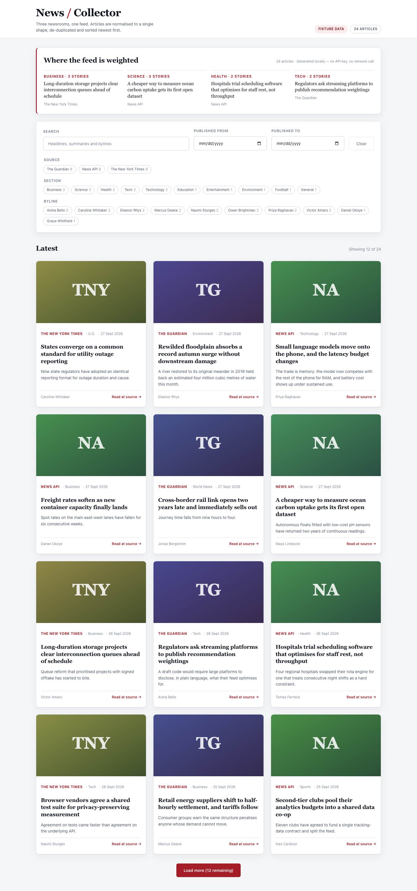
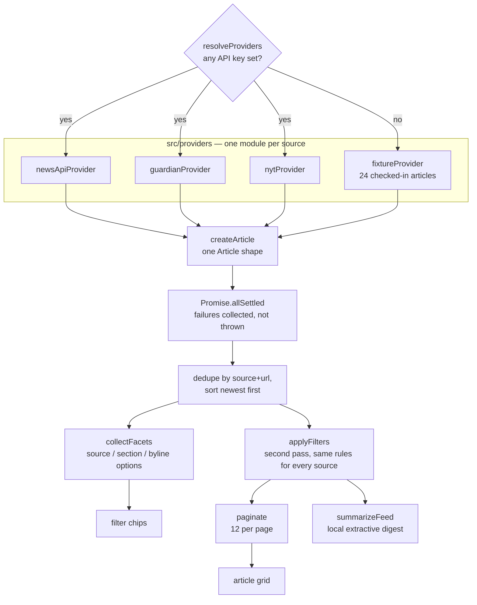
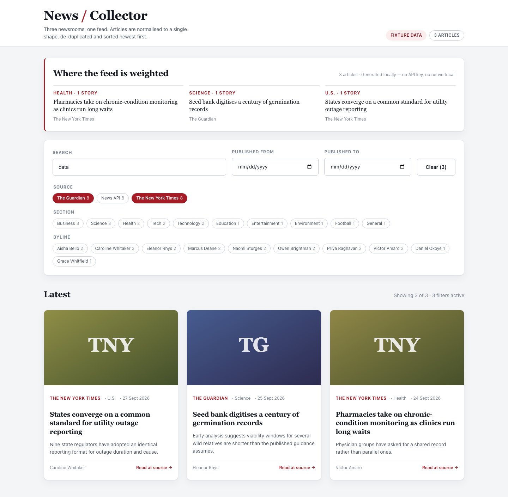

# News Collector

Three newsrooms — [NewsAPI](https://newsapi.org), [The Guardian](https://open-platform.theguardian.com)
and the [New York Times](https://developer.nytimes.com) — publish the same kind of thing in three
incompatible shapes. This pulls all three, flattens them into one `Article`, and renders a single
filterable feed.



It runs with **no API keys at all**. When nothing is configured the provider registry falls back to
a checked-in fixture of 24 articles, so `npm run dev` on a fresh clone gives you the page above
rather than an empty grid and a console error.

---

## Running it

```bash
npm install
npm run dev          # http://localhost:7141
```

That is the whole setup. To point it at the live APIs instead, copy the sample env file and fill in
whichever keys you have — one is enough:

```bash
cp .env.example .env.local
# set VITE_NEWSAPI_KEY / VITE_GUARDIAN_KEY / VITE_NYT_KEY
npm run dev
```

Other scripts: `npm test`, `npm run lint`, `npm run build`, `npm run preview`.

---

## Where the articles come from

Each source is a module in `src/providers/` satisfying one interface (`src/providers/types.js`):

| Provider | Id | Needs a key | Narrows upstream by |
|---|---|---|---|
| News API | `newsapi` | yes | keywords, date range, categories |
| The Guardian | `guardian` | yes | keywords, date range, categories |
| The New York Times | `nyt` | yes | keywords, date range, categories, byline |
| Local fixture | `fixture` | no | nothing — returns all 24 |

`resolveProviders()` picks the set to use: whatever `VITE_NEWS_SOURCES` names, else every provider
whose key is present, else the fixture. Nothing above the registry knows which branch was taken —
the UI just receives `Article[]`.

Because the three upstream APIs support *different* filters, narrowing happens twice: each provider
sends what its own API understands, then `applyFilters` runs over the merged result. Without that
second pass a byline filter would silently apply to NYT articles and not to Guardian ones.

---

## One refresh, end to end



Two things in that diagram are load-bearing:

**`Promise.allSettled`, not `Promise.all`.** These APIs are rate-limited and go down independently.
A failed source becomes a named entry in a banner above the feed; the other sources still render.
`tests/newsFeed.test.js` pins this with a provider that always throws.

**Facets come from the *unfiltered* set.** If the filter chips were derived from the filtered
result, selecting "The Guardian" would delete the other two source chips and strip you of any way
back. The feed service returns both lists for exactly this reason.

---

## Adding a fourth newsroom

Write a module exporting an object with `id`, `label`, `requiresKey`, `supports`, `isConfigured()`
and `fetchArticles()`, mapping the response through `createArticle`. Add it to `ALL_PROVIDERS` in
`src/providers/registry.js`. That is the entire change — `assertProvider` will fail loudly at import
time if the shape is wrong, and `tests/providers.test.js` runs its interface check over every
registered provider automatically.

---

## The digest

The panel at the top of the page is the one AI-shaped feature here, and it is deliberately small:
"where is this feed weighted, and what is the representative story in each of those sections".

It runs behind a provider interface (`src/ai/summarizer.js`) with two implementations:

- **`local` (default)** — no key, no network, fully deterministic. It groups articles by the section
  their publisher assigned, ranks sections by story count, and picks each section's most
  representative story by content-word overlap with the rest of that section. The per-card TL;DR
  line uses the same machinery on a single article: the sentence whose content words recur most.
- **`remote` (opt-in)** — posts to `VITE_SUMMARY_API_URL`, **an endpoint you host**, which holds the
  model key. Vite inlines `VITE_*` values into the browser bundle, so a model API key put in `.env`
  would ship to every visitor. Any failure — no URL, non-2xx, a body with no `bullets` — falls back
  to the local digest, so the panel always renders.

Why sections rather than mined keywords: across a few dozen short abstracts, raw term frequency
surfaces newsroom filler ("report", "published", "since") rather than subjects. The section is a
label an editor already chose.

---

## Filters live in the URL

Selecting a source, a section, a byline or a date bound rewrites the query string, so a filtered
feed is a link you can send someone and a reload keeps what you were looking at.



The keyword box is debounced by 300 ms so typing a word is one request rather than one per
keystroke, and fetched feeds are cached for 60 seconds keyed on `providers + filters` — a browser
reload, or toggling a chip off and on again, costs nothing against a rate-limited key.

---

## Configuration

Every environment-derived value is read in `src/config/env.js` and nowhere else, so tests can build
a config object and hand it to the registry without touching globals. Full list with comments in
[`.env.example`](.env.example); the ones you are most likely to touch:

| Variable | Default | Purpose |
|---|---|---|
| `VITE_NEWSAPI_KEY` / `VITE_GUARDIAN_KEY` / `VITE_NYT_KEY` | empty | enable a live source |
| `VITE_NEWS_SOURCES` | empty | explicit allow-list, e.g. `guardian,nyt` or `fixture` |
| `VITE_PAGE_SIZE` | `12` | articles per page before "Load more" |
| `VITE_REQUEST_TIMEOUT_MS` | `8000` | per-request abort deadline |
| `VITE_SUMMARY_PROVIDER` | `local` | `local` or `remote` |

Malformed numeric values fall back to the default rather than becoming `NaN`.

---

## Tests

```
$ npm test

 Test Files  8 passed (8)
      Tests  109 passed (109)
```

Vitest with jsdom. The suite covers the domain helpers, the HTTP layer (timeout, abort, non-2xx,
query building), each provider's wire-format mapping — including both shapes NYT has shipped for
`multimedia` — registry resolution, the fan-out and its partial-failure and cache behaviour, the
summariser and its fallbacks, and an integration pass over the rendered app in
`tests/feedPage.test.jsx`.

Those integration tests run with no environment variables set, which is the same state a fresh
clone is in, so they also assert that the app is usable with no API keys.

`npm run lint` (ESLint 9 flat config, `eslint-plugin-react` + `react-hooks`) reports no errors or
warnings.

---

## Containers

```bash
docker compose up --build       # http://localhost:7141
```

Multi-stage: `node:22-alpine` builds the bundle, `nginxinc/nginx-unprivileged` serves `dist/` as
uid 101 on port 8080, with a read-only root filesystem, `no-new-privileges`, and tmpfs mounts for
the paths nginx needs to write. The nginx config caches hashed assets for a year and marks
`index.html` `no-store`.

Because Vite inlines `VITE_*` at build time, keys are **build args**, not runtime environment. With
none supplied the image builds a fixture-mode bundle and still serves a populated feed.

> `docker compose config` parses cleanly. The image build and container boot have **not** been run
> in this environment — Docker was unavailable.

---

## What this does not do

- **No server.** It is a static bundle that calls the news APIs from the browser. That means the
  keys are in the bundle, which is fine for a public demo key and wrong for anything else — a real
  deployment wants a thin proxy holding the keys, and the provider interface is the seam where that
  would slot in.
- **One page of upstream results per source.** NewsAPI and the Guardian are asked for 40 articles
  each; NYT returns whatever its default page holds. The feed then paginates client-side over the
  merged set — no cursor is plumbed through to the upstream APIs, so "Load more" cannot reach page
  two of any of them.
- **Saved articles, accounts and push are absent.** There is no persistence beyond the query string.
- **Sections are not reconciled across sources.** The Guardian's "Tech" and NYT's "Tech" merge by
  luck of naming; NewsAPI reports its originating outlet in the same field. A source-to-canonical
  section map would fix it.
